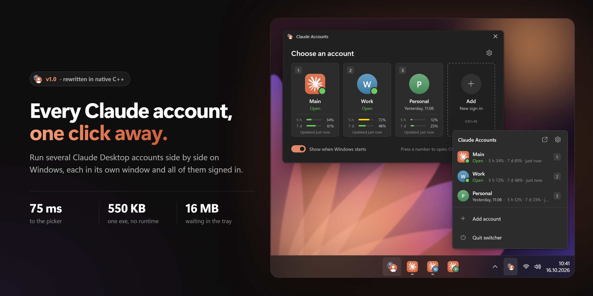
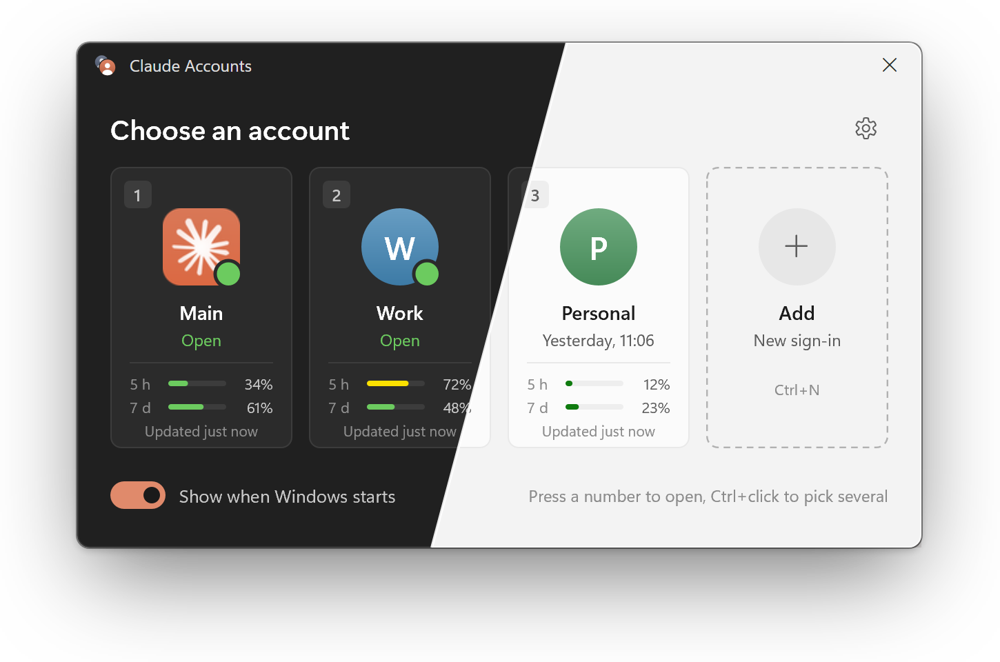
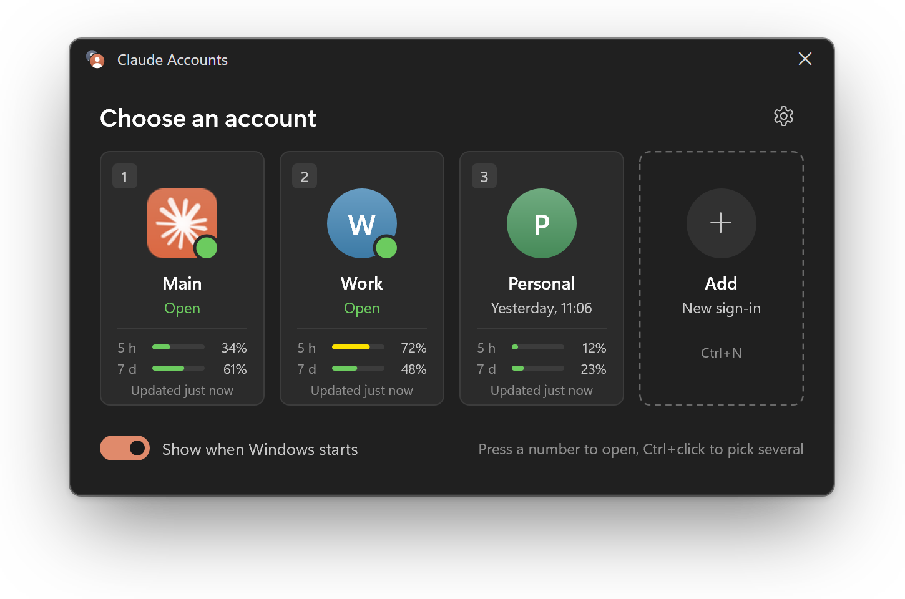
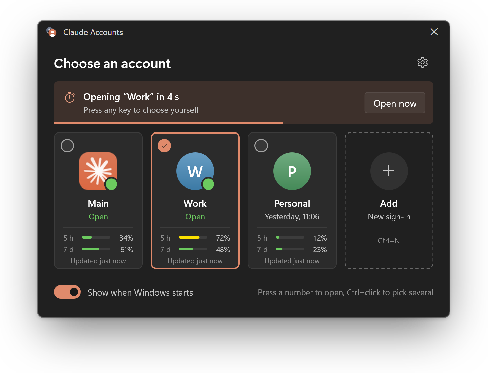
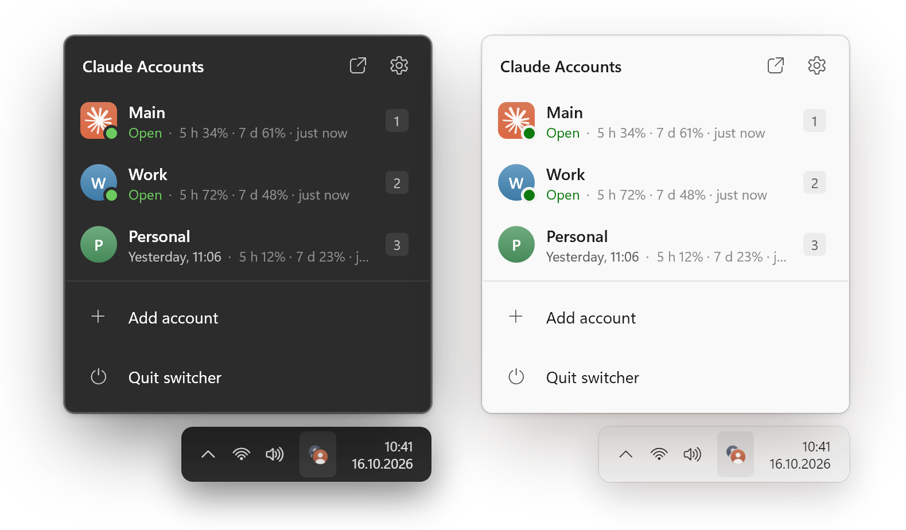
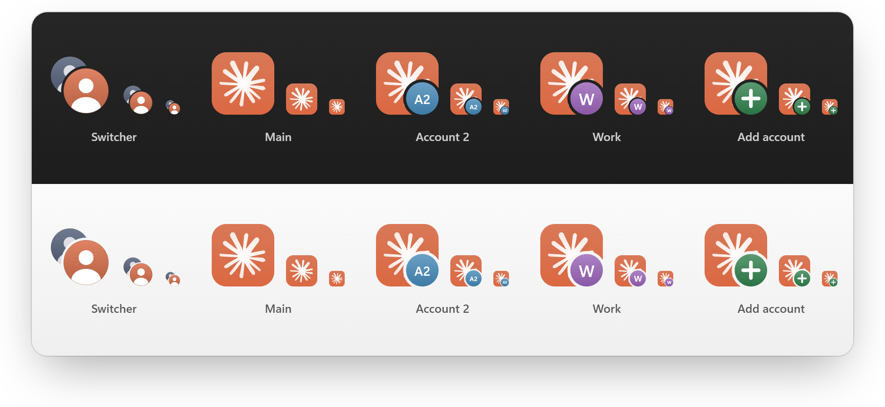
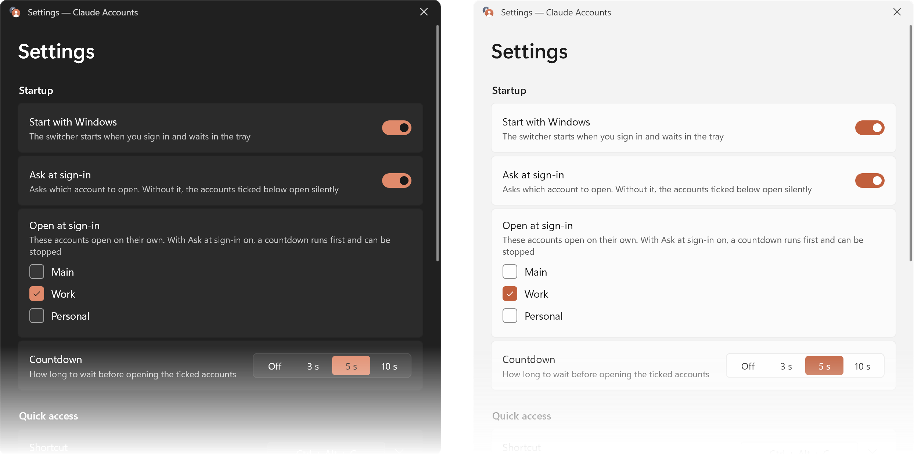
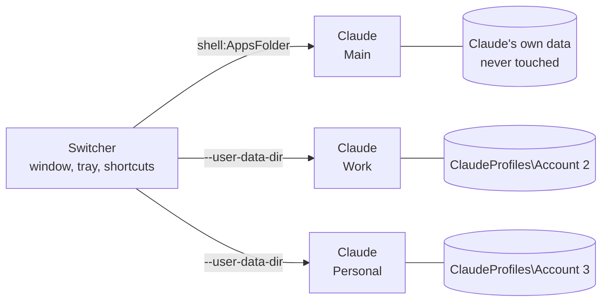

<div align="center">

<picture>
  <source media="(prefers-color-scheme: light)" srcset="docs/images/hero-light.png">
  
</picture>

# Claude Profile Switcher

**Several Claude Desktop accounts on one Windows PC: in separate windows, at the same time, without ever signing out.**

<sub>A native C++ rewrite of <a href="https://github.com/PriyanshuGeTRekT/Claude-Code-Desktop-Switcher">Claude Code Desktop Switcher</a> by @PriyanshuGeTRekT: same idea, about 130 times faster to open.</sub>

[](https://github.com/Piwqust/claude-profile-switcher/releases/latest)
[](https://github.com/Piwqust/claude-profile-switcher/releases)
[](https://github.com/Piwqust/claude-profile-switcher/actions/workflows/build.yml)
[](LICENSE)
<br>


<br>

<a href="https://github.com/Piwqust/claude-profile-switcher/releases/latest/download/ClaudeProfileSwitcher-x64.exe"></a>
&nbsp;
<a href="https://github.com/Piwqust/claude-profile-switcher/releases/latest/download/ClaudeProfileSwitcher-arm64.exe"></a>

<sub>One exe, nothing else to install · <a href="https://github.com/Piwqust/claude-profile-switcher/releases">all releases</a> · <a href="README.ru.md">Русский</a></sub>

</div>

---

Claude Desktop holds one sign-in at a time. Switching to your work account means signing out of your personal one and back in again. Claude Profile Switcher removes that: each account lives in its own window with its own sign-in, chats and settings, and you can have all of them open at once.

It is small and native: C++, Win32 and Direct2D, with no .NET, no Electron and no background service. The picker appears in about 70 ms. It follows the Windows theme, with Mica and rounded corners like the system's own Windows 11 windows, and speaks English or Russian.

## Built on Claude Code Desktop Switcher

Claude Profile Switcher started from [Claude Code Desktop Switcher](https://github.com/PriyanshuGeTRekT/Claude-Code-Desktop-Switcher) by [@PriyanshuGeTRekT](https://github.com/PriyanshuGeTRekT), the PowerShell script that worked out how to run several Claude Desktop accounts side by side. The idea and the files on disk are the same, so an existing setup carries straight over. Everything else was rewritten from scratch in C++: the interface, the launcher, the tray, the installer and the shell integration.

| | Claude Code Desktop Switcher 2.0 | Claude Profile Switcher 1.0 |
| --- | --- | --- |
| Written in | PowerShell and WinForms | C++, Win32, Direct2D, DirectWrite |
| What you run | a `.ps1` script through `powershell.exe` | one 550 KB exe |
| Window appears in | about 10 s | **about 75 ms** |
| Memory | about 126 MB | **about 16 MB** |
| Install | a PowerShell command with `-ExecutionPolicy Bypass` | run the exe |
| Builds | — | x64 and ARM64 |
| Interface | English, light only | English and Russian, dark and light, Mica |
| Ask at sign-in, countdown | — | ✓ |
| Global shortcuts | — | <kbd>Ctrl</kbd>+<kbd>Alt</kbd>+<kbd>C</kbd>, <kbd>Ctrl</kbd>+<kbd>Alt</kbd>+<kbd>1</kbd>…<kbd>9</kbd> |
| Usage on the cards | — | ✓ |
| Open several accounts at once | — | ✓ |
| Tray | right-click menu | flyout and menu |
| Jump list, a taskbar button per account | — | ✓ |
| Coloured shortcut icons, moving Code chats | ✓ | ✓ |

<sub>Measured on the same Windows 11 PC with three accounts: time from starting the program to a visible window, and private memory once it settles.</sub>

### Why it is faster

- **Nothing to start first.** The script has to start PowerShell and .NET, then compile its Win32 helpers with `Add-Type`, on every launch. The exe is native code, ready the moment Windows loads it.
- **Straight to the system.** Finding the Store build is one registry read instead of `Get-AppxPackage`. Open windows come from a process snapshot and `NtQueryInformationProcess` instead of a WMI query.
- **Its own drawing.** Each window is drawn by the switcher in one pass with Direct2D and DirectWrite, with no control tree to build. Slow work, such as the process list and profile files, runs on a background thread, so the window never waits for it.
- **Cheap to keep around.** In the tray it is a small exe and one hidden window, so the picker, the global shortcuts and desktop shortcuts all answer in milliseconds.

## Contents

- [Built on Claude Code Desktop Switcher](#built-on-claude-code-desktop-switcher)
- [Features](#features)
- [Install](#install)
- [Using it](#using-it)
- [Usage on the cards](#usage-on-the-cards)
- [Command line](#command-line)
- [How it works](#how-it-works)
- [Security and privacy](#security-and-privacy)
- [Uninstall](#uninstall)
- [Troubleshooting](#troubleshooting)
- [Building from source](#building-from-source)
- [Credits](#credits)

## Features

|  |  |
| --- | --- |
| 🪟 **Accounts in separate windows** | Every account is its own sign-in. Open as many as you need side by side. |
| ➕ **Add an account in one click** | **Add** opens a fresh Claude window at the sign-in screen. Sign in and you are done. |
| ⏱️ **Choose at Windows sign-in** | The switcher starts with Windows and asks which account to open, or opens the ones you ticked after a short countdown. |
| ⌨️ **Global shortcuts** | <kbd>Ctrl</kbd>+<kbd>Alt</kbd>+<kbd>C</kbd> brings up the picker from any app, <kbd>Ctrl</kbd>+<kbd>Alt</kbd>+<kbd>1</kbd>…<kbd>9</kbd> opens an account directly. |
| 📊 **Usage on the cards** | How much of the 5-hour and 7-day limits you have used. Shown only while current; stale figures are hidden. |
| ✅ **Several at once** | <kbd>Ctrl</kbd>+click the cards and open them all with one button. |
| 🧭 **Tray and taskbar** | Left-click the tray icon for the account list, right-click the taskbar button for the jump list, and optionally give every account its own taskbar button. |
| 🎨 **Icons you can tell apart** | Each account gets its own colour and initials on its shortcut, in the Start menu and on the taskbar. |
| 💬 **Move Claude Code chats** | Copy Code sessions from one account to another and pick up where you left off. |
| 🌐 **English and Russian** | Follows the Windows display language; pick one yourself in Settings → Language. |
| 🛡️ **Your original stays put** | The account you already have is never touched and keeps auto update and `claude://` links. |

<p align="center">
  
</p>

## Install

1. Download the exe for your processor:

   | Processor | File |
   | --- | --- |
   | Intel or AMD (almost every PC) | [ClaudeProfileSwitcher-x64.exe](https://github.com/Piwqust/claude-profile-switcher/releases/latest/download/ClaudeProfileSwitcher-x64.exe) |
   | ARM: Snapdragon, Surface Pro X and the like | [ClaudeProfileSwitcher-arm64.exe](https://github.com/Piwqust/claude-profile-switcher/releases/latest/download/ClaudeProfileSwitcher-arm64.exe) |

   Not sure which you have? Open **Settings → System → About** and look at **System type**.

2. Run it. It installs itself into `%LOCALAPPDATA%\ClaudeProfiles\.switcher`, adds shortcuts to the desktop and the Start menu, turns on start with Windows and opens the picker. No admin rights needed.

3. You can delete the downloaded file afterwards; the installed copy is what runs from then on.

> [!NOTE]
> The exe is not code-signed, so the first time you run it Windows may say "Windows protected your PC". Click **More info → Run anyway**. It happens once: the installed copy does not trigger it. To make sure the file is the one built here, compare its hash with `SHA256SUMS.txt` in the release:
>
> ```powershell
> Get-FileHash .\ClaudeProfileSwitcher-x64.exe -Algorithm SHA256
> ```

**You need** Windows 10 or 11 and [Claude Desktop](https://claude.ai/download), from the Microsoft Store or the installer. The switcher finds it on its own.

**Updating:** download the new version and run it. It closes the old one, takes its place and keeps every account, name and setting. Upgrading from the PowerShell switcher (v2) works the same way.

## Using it

### The picker

<picture><source media="(prefers-color-scheme: light)" srcset="docs/images/picker-light.png"></picture>

Each card shows the account's number, its name, whether it is open or when it was last used, and its usage when there is a current figure. A green dot means the account's window is already open: clicking it brings that window forward rather than starting a second copy.

**Adding your first extra account:**

1. Click **Add**. A new Claude window opens at the sign-in screen.
2. Sign in with your other account. From now on both stay signed in.
3. Press <kbd>F2</kbd> to rename `Account 2` to something like "Work". Only the label changes; the sign-in is unaffected.

The **⋯** menu on a card (or a right-click) has the rest: open it when Windows starts, a desktop shortcut, moving Code chats, the profile folder, and delete.

<br clear="right">

| Action | Mouse | Keyboard |
| --- | --- | --- |
| Open an account, or switch to its window | click the card | <kbd>1</kbd>…<kbd>9</kbd> or <kbd>Enter</kbd> |
| Pick several and open them together | <kbd>Ctrl</kbd>+click | <kbd>Space</kbd>, then <kbd>Enter</kbd> |
| Add an account | **Add** | <kbd>Ctrl</kbd>+<kbd>N</kbd> |
| Rename | ⋯ → Rename | <kbd>F2</kbd> |
| Delete an account | ⋯ → Delete | <kbd>Del</kbd> |
| Card menu | right-click or ⋯ | <kbd>Shift</kbd>+<kbd>F10</kbd> |
| Settings | ⚙ | <kbd>Ctrl</kbd>+<kbd>,</kbd> |
| Close the window | ✕ | <kbd>Esc</kbd> |
| Move between cards | | <kbd>Tab</kbd> and the arrow keys |

From any app: <kbd>Ctrl</kbd>+<kbd>Alt</kbd>+<kbd>C</kbd> for the picker, <kbd>Ctrl</kbd>+<kbd>Alt</kbd>+<kbd>1</kbd>…<kbd>9</kbd> for an account directly. You can change the picker's shortcut in Settings; if another app already uses it, Settings says so.

### At Windows sign-in

<picture><source media="(prefers-color-scheme: light)" srcset="docs/images/startup-light.png"></picture>

The switcher starts with Windows and then does one of two things:

- **Asks which account to open.** The picker appears as soon as you sign in.
- **Opens the ticked accounts on its own.** Tick them in a card's menu ("Open when Windows starts") or in Settings. A 3, 5 or 10 second countdown runs first; any key or click stops it so you can choose something else.

With **Ask at sign-in** off, the ticked accounts open without asking.

<br clear="right">

### Tray



Closing the window leaves the switcher in the tray, where it uses about 20 MB of memory and opens instantly.

- **Left-click** the icon for the account list with usage.
- **Right-click** it for the standard Windows menu: accounts, Add account…, Settings, Quit switcher.

If you would rather it quit with the window, turn off **Stay in the tray when closed** in Settings.

<br clear="right">

### Taskbar and shortcuts

- **Jump list.** Pin the switcher to the taskbar and right-click it to see every account.
- **A button per account.** Windows normally groups every Claude window under one button. Turn on **Separate taskbar buttons per account** in Settings and each window gets its own button and icon. This one is experimental.
- **Shortcuts.** **Desktop shortcut** in a card's menu creates `Claude - <name>`. Pin it to Start or the taskbar to open that account without the picker. Shortcuts keep working after Claude updates itself.

<p align="center">
  
</p>

### Settings

<p align="center">
  
</p>

Start with Windows, asking at sign-in, which accounts open on their own, the countdown, shortcuts, hiding the picker after opening an account, the tray, separate taskbar buttons and the interface language.

### Moving Claude Code chats

Card menu → **Move Code chats…**. Tick the chats and choose the account to copy them to. The chat stays in the original account too. Both copies carry on the same history, so finish in one account before picking it up in the other.

> [!NOTE]
> The account receiving the chats must have opened the Code tab at least once. If it is open, restart it to see them.

## Usage on the cards

The switcher shows how much of the 5-hour and 7-day limits each account has used. It never contacts Anthropic's servers and never touches tokens. The figures come from files already on your PC:

| Source | What it holds |
| --- | --- |
| `<profile>\plan-usage-history.json` | Claude Desktop's own record, one per profile |
| `%USERPROFILE%\.claude.json` | The last server answer Claude Code saved, matched to the account by its id |

A figure is shown only if it is at most 15 minutes old and its window has not reset since. Anything older is not shown at all: the account may have been used in the browser or the terminal in the meantime, and an out-of-date number would mislead. With no current figure, the meters are simply hidden.

## Command line

| Command | Does |
| --- | --- |
| `ClaudeProfileSwitcher.exe` | Opens the picker. Run from anywhere but its install folder, it installs itself first |
| `ClaudeProfileSwitcher.exe --launch "Work"` | Opens an account, or brings its window forward, then exits. Takes a name or a profile folder |
| `ClaudeProfileSwitcher.exe --add-account` | Adds an account and opens Claude at its sign-in screen |
| `ClaudeProfileSwitcher.exe --tray` | Starts in the tray only |
| `ClaudeProfileSwitcher.exe --startup` | What Windows runs at sign-in: the countdown or the picker |
| `ClaudeProfileSwitcher.exe --install` | Installs or refreshes the install, then opens the picker |
| `ClaudeProfileSwitcher.exe --claude-path "<dir>\Claude.exe"` | Points at Claude if it cannot be found. The choice is remembered |

## How it works

Claude Desktop is built on Electron, and Electron honours the standard `--user-data-dir` switch. A profile is just a directory with its own cookie jar, Local Storage and `config.json`, so every profile is a fully independent sign-in. Electron's "one copy of the app" lock is per directory too, which is why copies pointed at different directories run side by side instead of focusing each other.



What the switcher does, step by step:

1. **Finds Claude.** The Store build through the per-user package repository in the registry, the installer build through its uninstall entry. The result is cached and checked again when Claude updates.
2. **Keeps profiles.** Each extra account is a folder in `%LOCALAPPDATA%\ClaudeProfiles`. Names, colours and the other settings sit in `settings.json` next to them.
3. **Opens an account.** The main account starts through `shell:AppsFolder`, like the Start menu does. Others start as `Claude.exe --user-data-dir=<profile>`. If an account is already open, its window is brought forward instead.
4. **Watches what is open.** A process snapshot plus each process's command line maps running Claude windows to profiles, on a background thread.
5. **Fits into Windows.** Shortcuts get per-account icons drawn with Direct2D, the taskbar gets a jump list, start with Windows is one `Run` value, and the optional per-account taskbar buttons set each window's `AppUserModelID`.

<details>
<summary><b>What each account has to itself, and what is shared</b></summary>

**Separate per account:** sign-in, chats, window settings, cache, the Code chat list.

**Shared by all of them:**

- **Claude Code.** Its settings, plugins, MCP servers and session history live in `%USERPROFILE%\.claude` and `.claude.json`, one set for every account.
- **One code folder.** Code sessions in two windows working in the same repository can edit the same files at once.
- **Claude's own quick-entry hotkey** goes to whichever copy started first.
- **`claude://` links and Claude in Chrome** always use the main account.
- **Memory.** Each open account is a full copy of the app; budget roughly one Claude per window.
- **Updates.** Claude updates once for everyone. Windows already open stay on the old version until restarted.

</details>

<details>
<summary><b>Details that matter</b></summary>

- **The main account is never modified.** The Microsoft Store build is started through `shell:AppsFolder` rather than by running the exe, so it keeps its package identity: auto update, `claude://` links and native messaging behave exactly as before. The profiles the switcher creates live in `%LOCALAPPDATA%\ClaudeProfiles`, away from Claude's data.
- **Claude's path changes with every update**, because it contains the version number. Shortcuts look Claude up when clicked and carry their own icons, so they survive updates.
- **Open windows are detected by Claude Desktop's own process.** The Claude Code CLI is also called `claude.exe`; those processes are ignored.
- **Renaming changes a label only.** The folder name is a profile's permanent id, because Electron stores absolute paths inside its data.
- **Separate taskbar buttons** work by giving each account's windows their own `AppUserModelID`. Claude itself is not changed.

</details>

## Security and privacy

- **No network access.** The switcher makes no network requests at all: there is no networking code, no telemetry and no update check.
- **Sign-ins are never touched.** Tokens, cookies and passwords are not read or copied. Each account signs in by itself in its own Claude window.
- **Claude is not modified.** Only standard Electron and Windows mechanisms; no patching, no proxy.
- **No admin rights.** Everything goes into your user profile: `%LOCALAPPDATA%\ClaudeProfiles` and an `HKCU\…\Run` value for start with Windows.
- **Built in the open.** Every release is built by [GitHub Actions](https://github.com/Piwqust/claude-profile-switcher/actions) from this repository, with SHA-256 checksums next to the files.

Found a vulnerability? See [SECURITY.md](SECURITY.md).

## Uninstall

1. In Settings, turn off **Start with Windows**, then choose **Quit switcher** in the tray.
2. Delete `%LOCALAPPDATA%\ClaudeProfiles\.switcher` and the `Claude Profile Switcher` and `Claude - …` shortcuts on the desktop and in the Start menu.
3. To remove the extra accounts and their sign-ins too, delete all of `%LOCALAPPDATA%\ClaudeProfiles`. Your main Claude account is unaffected.

## Troubleshooting

<details>
<summary><b>"Couldn't find the Claude app on this PC"</b></summary>

The switcher offers to let you pick `Claude.exe` yourself and remembers the choice. `--claude-path` does the same.
</details>

<details>
<summary><b>The global shortcut does nothing</b></summary>

Most likely another app already uses it. Settings then says "Another app already uses this shortcut"; choose a different one there.
</details>

<details>
<summary><b>No usage on the cards</b></summary>

There is no current figure: Claude has not written one yet, or it is older than 15 minutes. Open the account and use it for a while; the meters appear when Claude updates them.
</details>

<details>
<summary><b>A desktop shortcut does not open anything</b></summary>

Errors are shown in a window and written to `%LOCALAPPDATA%\ClaudeProfiles\switcher-error.log`. If a profile was deleted or renamed outside the switcher, its old shortcut says there is no such account.
</details>

<details>
<summary><b>The interface is in the wrong language</b></summary>

By default it follows the Windows display language: Russian when Windows is in Russian, English otherwise. Settings → Language → **English** or **Русский** pins one.
</details>

## Building from source

You need Visual Studio 2022 or the Build Tools with "Desktop development with C++". For ARM64 add "MSVC ARM64 build tools".

```bat
git clone https://github.com/Piwqust/claude-profile-switcher.git
cd claude-profile-switcher
build.cmd           :: build\x64\ClaudeProfileSwitcher.exe
build.cmd arm64     :: build\arm64\ClaudeProfileSwitcher.exe
```

To look at the interface without real accounts, start the demo over made-up profiles: `.\tools\demo.ps1` (add `-Language ru` or `-Theme light`). It never starts Claude and leaves your shortcuts and settings alone. How the code is laid out and what to check before a pull request is in [CONTRIBUTING.md](CONTRIBUTING.md).

## Credits

Built on [Claude Code Desktop Switcher](https://github.com/PriyanshuGeTRekT/Claude-Code-Desktop-Switcher) by [@PriyanshuGeTRekT](https://github.com/PriyanshuGeTRekT), which pioneered running Claude Desktop accounts side by side with `--user-data-dir`, and is MIT-licensed like this project. Thank you! What changed in the rewrite is described in [Built on Claude Code Desktop Switcher](#built-on-claude-code-desktop-switcher).

## Disclaimer

Unofficial, and not affiliated with, endorsed by or supported by Anthropic. Claude is a trademark of Anthropic. Using multiple accounts is subject to [Anthropic's terms](https://www.anthropic.com/legal/consumer-terms).

## License

[MIT](LICENSE)
