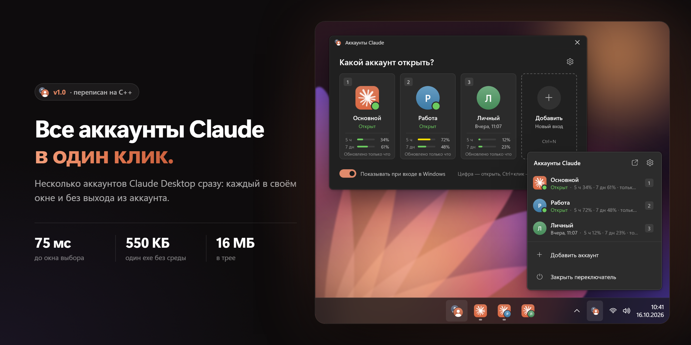
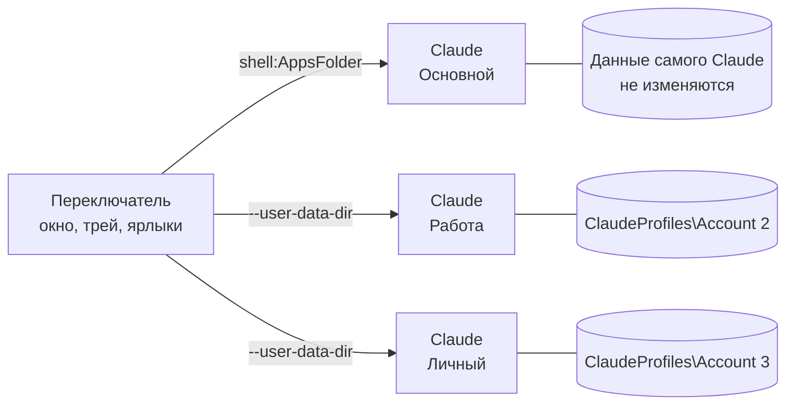

<div align="center">

<picture>
  <source media="(prefers-color-scheme: light)" srcset="docs/images/ru/hero-light.png">
  
</picture>

# Claude Profile Switcher

**Несколько аккаунтов Claude на одном компьютере с Windows: в разных окнах, одновременно и без выхода из аккаунта.**

<sub>Нативная версия <a href="https://github.com/PriyanshuGeTRekT/Claude-Code-Desktop-Switcher">Claude Code Desktop Switcher</a> от @PriyanshuGeTRekT, переписанная на C++: та же идея, а окно открывается примерно в 130 раз быстрее.</sub>

[](https://github.com/Piwqust/claude-profile-switcher/releases/latest)
[](https://github.com/Piwqust/claude-profile-switcher/releases)
[](https://github.com/Piwqust/claude-profile-switcher/actions/workflows/build.yml)
[](LICENSE)
<br>


<br>

<a href="https://github.com/Piwqust/claude-profile-switcher/releases/latest/download/ClaudeProfileSwitcher-x64.exe"></a>
&nbsp;
<a href="https://github.com/Piwqust/claude-profile-switcher/releases/latest/download/ClaudeProfileSwitcher-arm64.exe"></a>

<sub>Один exe, ничего ставить не нужно · <a href="https://github.com/Piwqust/claude-profile-switcher/releases">все версии</a> · <a href="README.md">English</a></sub>

</div>

---

Claude Desktop умеет держать только один вход. Чтобы переключиться на рабочий аккаунт, приходится выходить из личного и входить заново. Claude Profile Switcher снимает это ограничение: каждый аккаунт живёт в своём окне со своим входом, перепиской и настройками. Открыть их можно все сразу.

Программа маленькая и родная для Windows: C++, Win32 и Direct2D, без .NET, Electron и фоновых служб. Окно выбора появляется примерно за 70 мс. Тёмная и светлая темы, Mica и скругления — как у системных окон Windows 11. Интерфейс на английском и русском.

## Основа — Claude Code Desktop Switcher

Claude Profile Switcher вырос из [Claude Code Desktop Switcher](https://github.com/PriyanshuGeTRekT/Claude-Code-Desktop-Switcher) от [@PriyanshuGeTRekT](https://github.com/PriyanshuGeTRekT). Это скрипт на PowerShell, в котором впервые придумали, как запускать несколько аккаунтов Claude Desktop одновременно. Идея и файлы на диске остались прежними, поэтому существующие аккаунты переносятся сами. Всё остальное переписано с нуля на C++: интерфейс, запуск, трей, установка и встраивание в Windows.

| | Claude Code Desktop Switcher 2.0 | Claude Profile Switcher 1.0 |
| --- | --- | --- |
| Написан на | PowerShell и WinForms | C++, Win32, Direct2D, DirectWrite |
| Что запускается | скрипт `.ps1` через `powershell.exe` | один exe на 550 КБ |
| Окно появляется за | около 10 с | **около 75 мс** |
| Память | около 126 МБ | **около 16 МБ** |
| Установка | команда PowerShell с `-ExecutionPolicy Bypass` | запустить exe |
| Сборки | — | x64 и ARM64 |
| Интерфейс | английский, только светлая тема | английский и русский, тёмная и светлая темы, Mica |
| Выбор при входе, отсчёт | — | ✓ |
| Глобальные горячие клавиши | — | <kbd>Ctrl</kbd>+<kbd>Alt</kbd>+<kbd>C</kbd>, <kbd>Ctrl</kbd>+<kbd>Alt</kbd>+<kbd>1</kbd>…<kbd>9</kbd> |
| Лимиты на карточках | — | ✓ |
| Несколько аккаунтов разом | — | ✓ |
| Трей | меню по правому клику | панель и меню |
| Список переходов, своя кнопка на панели задач | — | ✓ |
| Цветные значки ярлыков, перенос чатов Code | ✓ | ✓ |

<sub>Замерено на одном и том же ПК с Windows 11 и тремя аккаунтами: время от запуска программы до появления окна и личная память процесса после запуска.</sub>

### Почему быстрее

- **Нечего запускать заранее.** Скрипту при каждом старте нужно поднять PowerShell и .NET, а потом скомпилировать свои Win32-обёртки через `Add-Type`. Exe — это машинный код, он готов сразу после загрузки.
- **Напрямую к системе.** Версию из Store переключатель находит одним чтением реестра вместо `Get-AppxPackage`. Открытые окна он узнаёт из снимка процессов и `NtQueryInformationProcess` вместо запроса WMI.
- **Свой рендеринг.** Каждое окно рисуется за один проход через Direct2D и DirectWrite, без дерева элементов управления. Медленная работа — список процессов, файлы профилей — идёт в фоновом потоке, и окно её не ждёт.
- **Дёшево держать в трее.** В трее это маленький exe и одно скрытое окно, поэтому окно выбора, горячие клавиши и ярлыки срабатывают за миллисекунды.

## Содержание

- [Основа — Claude Code Desktop Switcher](#основа--claude-code-desktop-switcher)
- [Возможности](#возможности)
- [Установка](#установка)
- [Как пользоваться](#как-пользоваться)
- [Лимиты на карточках](#лимиты-на-карточках)
- [Командная строка](#командная-строка)
- [Как это работает](#как-это-работает)
- [Безопасность и приватность](#безопасность-и-приватность)
- [Удаление](#удаление)
- [Решение проблем](#решение-проблем)
- [Сборка из исходников](#сборка-из-исходников)
- [Благодарности](#благодарности)

## Возможности

|  |  |
| --- | --- |
| 🪟 **Аккаунты в отдельных окнах** | Каждый аккаунт — отдельный вход. Открывайте сколько нужно одновременно. |
| ➕ **Новый аккаунт в один клик** | «Добавить» открывает чистое окно Claude на экране входа. Вошли — готово. |
| ⏱️ **Выбор при входе в Windows** | Переключатель стартует вместе с системой и спрашивает, какой аккаунт открыть. Отмеченные аккаунты откроются сами после короткого отсчёта. |
| ⌨️ **Горячие клавиши** | <kbd>Ctrl</kbd>+<kbd>Alt</kbd>+<kbd>C</kbd> вызывает окно выбора из любой программы, <kbd>Ctrl</kbd>+<kbd>Alt</kbd>+<kbd>1</kbd>…<kbd>9</kbd> сразу открывает нужный аккаунт. |
| 📊 **Лимиты на карточках** | Сколько использовано за 5 часов и за 7 дней. Показываются только свежие данные, устаревшие скрываются. |
| ✅ **Несколько аккаунтов сразу** | <kbd>Ctrl</kbd>+клик по карточкам и одна кнопка, чтобы открыть их все. |
| 🧭 **Трей и панель задач** | Клик по значку в трее показывает список аккаунтов. Список переходов на панели задач. По желанию у каждого аккаунта своя кнопка на панели задач. |
| 🎨 **Значки, которые легко различить** | У каждого аккаунта свой цвет и буква на ярлыке, в меню «Пуск» и на панели задач. |
| 💬 **Перенос чатов Claude Code** | Скопируйте сессии Code из одного аккаунта в другой и продолжайте с того же места. |
| 🌐 **Английский и русский** | Язык повторяет язык Windows. Выбрать вручную можно в «Настройки → Язык». |
| 🛡️ **Основной аккаунт не трогается** | Ваш текущий вход остаётся как есть, с автообновлением и ссылками `claude://`. |

<p align="center">
  
</p>

## Установка

1. Скачайте exe для своего процессора:

   | Процессор | Файл |
   | --- | --- |
   | Intel или AMD (почти все ПК) | [ClaudeProfileSwitcher-x64.exe](https://github.com/Piwqust/claude-profile-switcher/releases/latest/download/ClaudeProfileSwitcher-x64.exe) |
   | ARM: Snapdragon, Surface Pro X и подобные | [ClaudeProfileSwitcher-arm64.exe](https://github.com/Piwqust/claude-profile-switcher/releases/latest/download/ClaudeProfileSwitcher-arm64.exe) |

   Не знаете, какой у вас? Откройте **Параметры → Система → О системе** и посмотрите строку **Тип системы**.

2. Запустите скачанный файл. Программа сама установится в `%LOCALAPPDATA%\ClaudeProfiles\.switcher`, добавит ярлыки на рабочий стол и в меню «Пуск», включит запуск вместе с Windows и откроет окно выбора. Права администратора не нужны.

3. Скачанный файл после этого можно удалить: дальше работает установленная копия.

> [!NOTE]
> Exe не подписан сертификатом, поэтому при первом запуске Windows может показать «Windows защитил ваш компьютер». Нажмите **Подробнее → Выполнить в любом случае**. Это предупреждение появляется один раз: установленная копия его уже не вызывает. Если хотите убедиться, что файл не подменён, сверьте контрольную сумму с `SHA256SUMS.txt` в релизе:
>
> ```powershell
> Get-FileHash .\ClaudeProfileSwitcher-x64.exe -Algorithm SHA256
> ```

**Что нужно:** Windows 10 или 11 и установленный [Claude Desktop](https://claude.ai/download) — из Microsoft Store или с сайта. Программа находит его сама.

**Обновление:** скачайте новую версию и запустите её. Она закроет старую, займёт её место и сохранит все аккаунты, имена и настройки. С переключателя на PowerShell (v2) тоже можно обновиться поверх.

## Как пользоваться

### Окно выбора

<picture><source media="(prefers-color-scheme: light)" srcset="docs/images/ru/picker-light.png"></picture>

На каждой карточке — номер, имя аккаунта, открыт он или когда открывался в последний раз, и лимиты, если о них есть свежие данные. Зелёная точка значит, что окно этого аккаунта уже открыто. Клик по такой карточке выводит окно на передний план и не запускает вторую копию.

**Первый новый аккаунт:**

1. Нажмите **Добавить**. Откроется новое окно Claude на экране входа.
2. Войдите в другой аккаунт. С этого момента оба аккаунта остаются в системе.
3. Нажмите <kbd>F2</kbd>, чтобы переименовать `Account 2`, например, в «Работа». Меняется только подпись, вход не затрагивается.

Меню «⋯» на карточке (или правый клик) содержит остальное: «Открывать при входе в Windows», ярлык на рабочий стол, перенос чатов Code, папку профиля и удаление.

<br clear="right">

| Действие | Мышь | Клавиатура |
| --- | --- | --- |
| Открыть аккаунт или перейти к его окну | клик по карточке | <kbd>1</kbd>…<kbd>9</kbd> или <kbd>Enter</kbd> |
| Выбрать несколько и открыть разом | <kbd>Ctrl</kbd>+клик | <kbd>Пробел</kbd>, затем <kbd>Enter</kbd> |
| Добавить аккаунт | **Добавить** | <kbd>Ctrl</kbd>+<kbd>N</kbd> |
| Переименовать | ⋯ → Переименовать | <kbd>F2</kbd> |
| Удалить аккаунт | ⋯ → Удалить | <kbd>Del</kbd> |
| Меню карточки | правый клик или ⋯ | <kbd>Shift</kbd>+<kbd>F10</kbd> |
| Настройки | ⚙ | <kbd>Ctrl</kbd>+<kbd>,</kbd> |
| Закрыть окно | ✕ | <kbd>Esc</kbd> |
| Перемещаться между карточками | | <kbd>Tab</kbd> и стрелки |

Из любой программы: <kbd>Ctrl</kbd>+<kbd>Alt</kbd>+<kbd>C</kbd> — окно выбора, <kbd>Ctrl</kbd>+<kbd>Alt</kbd>+<kbd>1</kbd>…<kbd>9</kbd> — сразу нужный аккаунт. Сочетание для окна выбора можно поменять в настройках. Если его уже заняла другая программа, переключатель об этом скажет.

### При входе в Windows

<picture><source media="(prefers-color-scheme: light)" srcset="docs/images/ru/startup-light.png"></picture>

Переключатель стартует вместе с системой. Дальше есть два варианта:

- **Спросить, какой аккаунт открыть.** Окно выбора появляется сразу после входа.
- **Открыть отмеченные сами.** Отметьте аккаунты в меню карточки («Открывать при входе в Windows») или в настройках. Перед открытием идёт отсчёт: 3, 5 или 10 секунд. Любая клавиша или клик останавливает его, и можно выбрать другой аккаунт.

Если окно выбора при входе выключено, отмеченные аккаунты откроются без вопросов.

<br clear="right">

### Трей


После закрытия окна переключатель остаётся в трее. Он занимает около 20 МБ памяти и открывает окно мгновенно.

- **Левый клик** по значку открывает список аккаунтов с лимитами.
- **Правый клик** открывает обычное меню Windows: аккаунты, «Добавить аккаунт…», «Настройки», «Закрыть переключатель».

Если трей не нужен, выключите в настройках «Оставаться в трее после закрытия окна»: переключатель будет закрываться вместе с окном.

<br clear="right">

### Панель задач и ярлыки

- **Список переходов.** Закрепите переключатель на панели задач. Правый клик по кнопке покажет все аккаунты.
- **Отдельная кнопка для каждого аккаунта.** Обычно Windows собирает все окна Claude в одну кнопку. Включите в настройках «Отдельные кнопки аккаунтов на панели задач», и у каждого окна появятся своя кнопка и свой значок. Функция экспериментальная.
- **Ярлыки.** «Ярлык на рабочий стол» в меню карточки создаёт `Claude - <имя>`. Его можно закрепить в «Пуске» или на панели задач и открывать аккаунт без окна выбора. Ярлыки продолжают работать после обновлений Claude.

<p align="center">
  
</p>

### Настройки

<p align="center">
  
</p>

Запуск вместе с Windows, окно выбора при входе, какие аккаунты открывать сами, длительность отсчёта, горячие клавиши, скрытие окна после запуска аккаунта, трей, отдельные кнопки на панели задач и язык интерфейса.

### Перенос чатов Claude Code

Меню карточки → **Перенести чаты Code…**. Отметьте чаты и выберите, в какой аккаунт их скопировать. В исходном аккаунте чат тоже останется. Обе копии продолжают одну и ту же историю, поэтому заканчивайте работу в одном аккаунте, прежде чем продолжать в другом.

> [!NOTE]
> В аккаунте, куда переносятся чаты, нужно хотя бы раз открыть вкладку Code. Если этот аккаунт открыт, перезапустите его, чтобы чаты появились.

## Лимиты на карточках

Переключатель показывает, сколько процентов лимита использовано за 5 часов и за 7 дней. Он не обращается к серверам Anthropic и не трогает токены. Цифры берутся из файлов, которые уже лежат на вашем компьютере:

| Источник | Что там |
| --- | --- |
| `<профиль>\plan-usage-history.json` | Записи самого Claude Desktop, отдельные для каждого профиля |
| `%USERPROFILE%\.claude.json` | Последний ответ сервера, который сохранил Claude Code. Сопоставляется с аккаунтом по его идентификатору |

Цифра показывается, только если ей не больше 15 минут и лимит с тех пор не сбрасывался. Более старые данные не показываются совсем: аккаунт могли использовать в браузере или в терминале, и устаревшая цифра ввела бы в заблуждение. Когда свежих данных нет, блок с лимитами просто скрыт.

## Командная строка

| Команда | Что делает |
| --- | --- |
| `ClaudeProfileSwitcher.exe` | Открывает окно выбора. Если запущен не из папки установки — сначала устанавливается |
| `ClaudeProfileSwitcher.exe --launch "Работа"` | Открывает аккаунт или выводит его окно вперёд, затем завершается. Принимает имя или папку профиля |
| `ClaudeProfileSwitcher.exe --add-account` | Добавляет аккаунт и открывает Claude на экране входа |
| `ClaudeProfileSwitcher.exe --tray` | Запускает переключатель только в трее |
| `ClaudeProfileSwitcher.exe --startup` | То же, что делает Windows при входе: отсчёт или окно выбора |
| `ClaudeProfileSwitcher.exe --install` | Устанавливает или обновляет установку, потом открывает окно выбора |
| `ClaudeProfileSwitcher.exe --claude-path "<путь>\Claude.exe"` | Указывает путь к Claude, если его не удалось найти. Выбор запоминается |

## Как это работает

Claude Desktop построен на Electron, а Electron поддерживает стандартный параметр `--user-data-dir`. Профиль — это просто отдельная папка со своими cookie, локальным хранилищем и `config.json`. Поэтому каждый профиль — полностью независимый вход. Блокировка «только одна копия приложения» тоже действует в пределах папки. Копии с разными папками работают параллельно и не перехватывают друг друга.



Что переключатель делает, по шагам:

1. **Находит Claude.** Версию из Store — по реестру пакетов пользователя, версию с сайта — по записи об установке. Результат запоминается и перепроверяется, когда Claude обновляется.
2. **Хранит профили.** Каждый дополнительный аккаунт — это папка в `%LOCALAPPDATA%\ClaudeProfiles`. Имена, цвета и остальные настройки лежат рядом, в `settings.json`.
3. **Открывает аккаунт.** Основной запускается через `shell:AppsFolder`, как из меню «Пуск». Остальные — как `Claude.exe --user-data-dir=<профиль>`. Если аккаунт уже открыт, его окно просто выводится вперёд.
4. **Следит за открытыми окнами.** Снимок процессов и командная строка каждого процесса сопоставляют окна Claude с профилями. Всё это идёт в фоновом потоке.
5. **Встраивается в Windows.** Ярлыки получают значки аккаунтов, нарисованные через Direct2D. На панели задач появляется список переходов, автозапуск — это одно значение `Run`. Отдельные кнопки на панели задач задают каждому окну свой `AppUserModelID`.

<details>
<summary><b>Что у аккаунтов своё, а что общее</b></summary>

**У каждого аккаунта своё:** вход, переписка, настройки окна, кэш, список чатов Code.

**Общее для всех:**

- **Claude Code.** Его настройки, плагины, MCP-серверы и история сессий лежат в `%USERPROFILE%\.claude` и `.claude.json`. Это общая папка, у всех аккаунтов настройки Code одинаковые.
- **Одна папка с кодом.** Если в двух окнах запустить сессии Code в одном репозитории, они могут одновременно править одни и те же файлы.
- **Горячая клавиша самого Claude** (быстрый ввод) достаётся той копии, которая запустилась первой.
- **Ссылки `claude://` и расширение Claude для Chrome** всегда работают с основным аккаунтом.
- **Память.** Каждый открытый аккаунт — полноценная копия приложения. Рассчитывайте примерно на одного Claude на каждое окно.
- **Обновления.** Claude обновляется один раз для всех. Уже открытые окна остаются на старой версии до перезапуска.

</details>

<details>
<summary><b>Подробности, которые важны</b></summary>

- **Основной аккаунт не изменяется.** Версия из Microsoft Store запускается через `shell:AppsFolder`, а не напрямую через exe. Поэтому у неё сохраняются автообновление, ссылки `claude://` и native messaging. Профили, которые создаёт переключатель, лежат в `%LOCALAPPDATA%\ClaudeProfiles`, отдельно от данных Claude.
- **Путь к Claude меняется с каждым обновлением**, потому что в нём номер версии. Ярлыки ищут Claude в момент клика и хранят свои значки, поэтому переживают обновления.
- **Открытые окна определяются по процессу самого Claude Desktop.** Claude Code CLI тоже называется `claude.exe`, такие процессы не учитываются.
- **Переименование меняет только подпись.** Имя папки — постоянный идентификатор профиля, потому что Electron хранит внутри данных абсолютные пути.
- **Отдельные кнопки на панели задач** работают так: переключатель задаёт окнам аккаунтов свой `AppUserModelID`. Сам Claude при этом не изменяется.

</details>

## Безопасность и приватность

- **Нет сети.** Переключатель не делает ни одного сетевого запроса: в нём нет кода для работы с сетью, телеметрии и проверки обновлений.
- **Не трогает вход.** Токены, cookie и пароли не читаются и не копируются. Каждый аккаунт входит сам в своём окне Claude.
- **Claude не изменяется.** Используются только стандартные параметры Electron и Windows. Файлы Claude не патчатся, прокси нет.
- **Без прав администратора.** Всё ставится в профиль пользователя: `%LOCALAPPDATA%\ClaudeProfiles` и ключ `HKCU\…\Run` для автозапуска.
- **Открытый код.** Каждый релиз собирается в [GitHub Actions](https://github.com/Piwqust/claude-profile-switcher/actions) из этого репозитория, контрольные суммы лежат рядом с файлами.

Нашли уязвимость? Напишите по инструкции в [SECURITY.md](SECURITY.md).

## Удаление

1. В настройках выключите «Запускать вместе с Windows», затем в трее выберите «Закрыть переключатель».
2. Удалите папку `%LOCALAPPDATA%\ClaudeProfiles\.switcher` и ярлыки `Claude Profile Switcher`, `Claude - …` на рабочем столе и в меню «Пуск».
3. Чтобы удалить и сами профили со входами, удалите всю папку `%LOCALAPPDATA%\ClaudeProfiles`. Основной аккаунт Claude при этом не пострадает.

## Решение проблем

<details>
<summary><b>«Не удалось найти приложение Claude»</b></summary>

Переключатель предложит выбрать `Claude.exe` вручную, выбор запомнится. То же самое делает `--claude-path`.
</details>

<details>
<summary><b>Горячая клавиша не срабатывает</b></summary>

Скорее всего, сочетание заняла другая программа. В настройках появится «Это сочетание занято другой программой» — задайте там другое.
</details>

<details>
<summary><b>Лимиты не показываются</b></summary>

Значит, свежих данных нет: Claude ещё не записал их или они старше 15 минут. Откройте аккаунт и поработайте в нём. Цифры появятся, когда Claude их обновит.
</details>

<details>
<summary><b>Интерфейс не на том языке</b></summary>

По умолчанию язык повторяет язык Windows: русский, если Windows на русском, иначе английский. «Настройки → Язык» → **English** или **Русский** закрепляет нужный.
</details>

<details>
<summary><b>Ярлык ничего не открывает</b></summary>

Ошибки показываются в окне и пишутся в `%LOCALAPPDATA%\ClaudeProfiles\switcher-error.log`. Если профиль удалили или переименовали не через переключатель, старый ярлык сообщит, что такого аккаунта нет.
</details>

## Сборка из исходников

Нужна Visual Studio 2022 (или Build Tools) с компонентом «Разработка классических приложений на C++». Для ARM64 добавьте «MSVC ARM64 build tools».

```bat
git clone https://github.com/Piwqust/claude-profile-switcher.git
cd claude-profile-switcher
build.cmd           :: build\x64\ClaudeProfileSwitcher.exe
build.cmd arm64     :: build\arm64\ClaudeProfileSwitcher.exe
```

Чтобы посмотреть интерфейс без настоящих аккаунтов, запустите демо с вымышленными профилями: `.\tools\demo.ps1 -Language ru`. Оно не запускает Claude и не трогает ваши ярлыки и настройки. Как устроен код и что проверить перед пулл-реквестом, описано в [CONTRIBUTING.md](CONTRIBUTING.md).

## Благодарности

Основа — [Claude Code Desktop Switcher](https://github.com/PriyanshuGeTRekT/Claude-Code-Desktop-Switcher) от [@PriyanshuGeTRekT](https://github.com/PriyanshuGeTRekT): там впервые запустили аккаунты Claude Desktop рядом через `--user-data-dir`. Он, как и этот проект, распространяется по лицензии MIT. Спасибо! Что изменилось при переписывании, описано в разделе [Основа — Claude Code Desktop Switcher](#основа--claude-code-desktop-switcher).

## Отказ от ответственности

Неофициальный проект. Он не связан с Anthropic, не одобрен и не поддерживается ею. Claude — товарный знак Anthropic. Использование нескольких аккаунтов регулируется [условиями использования Anthropic](https://www.anthropic.com/legal/consumer-terms).

## Лицензия

[MIT](LICENSE)
