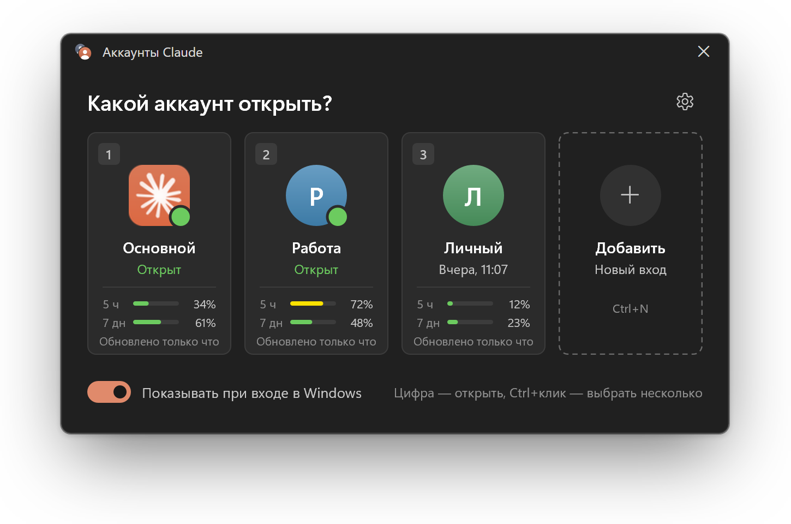
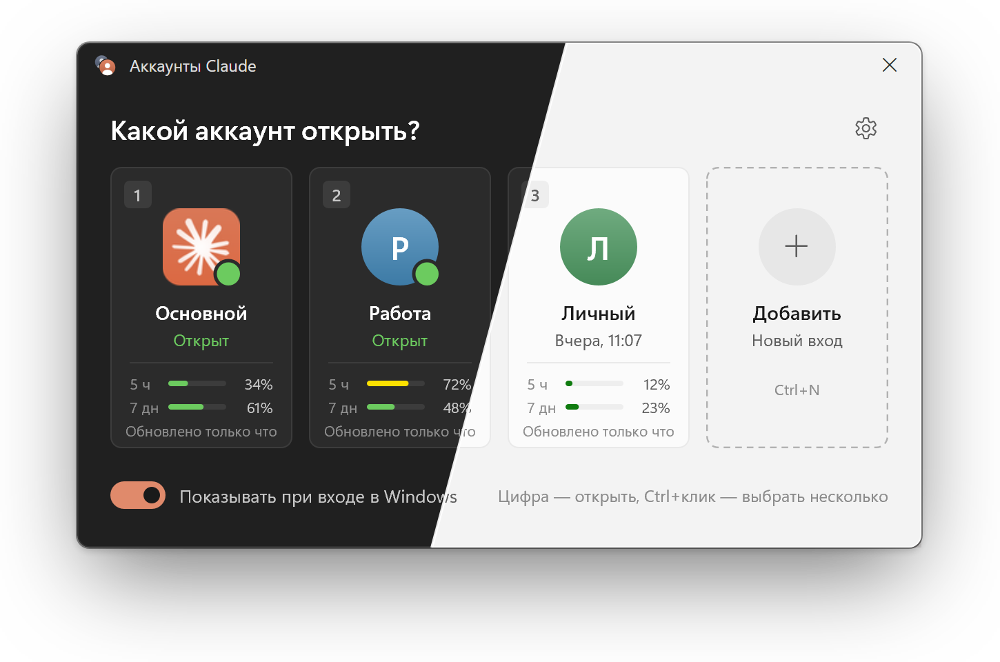
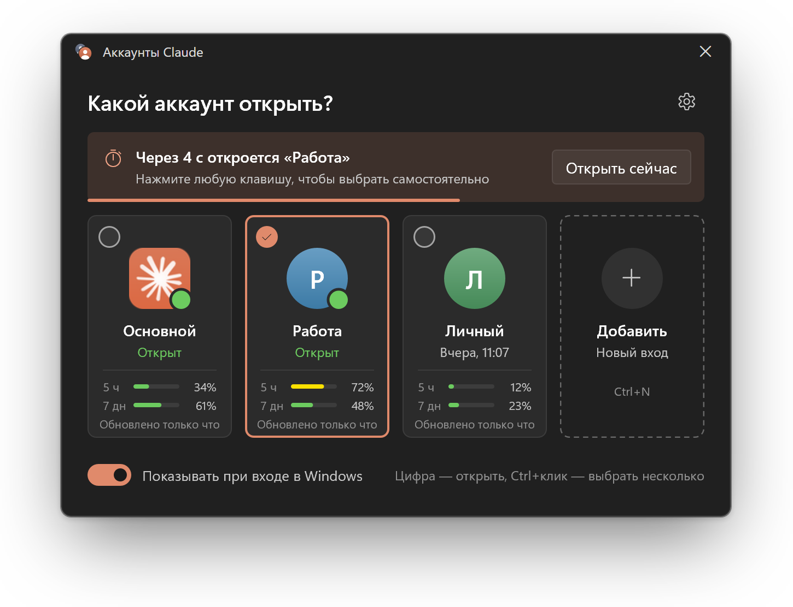
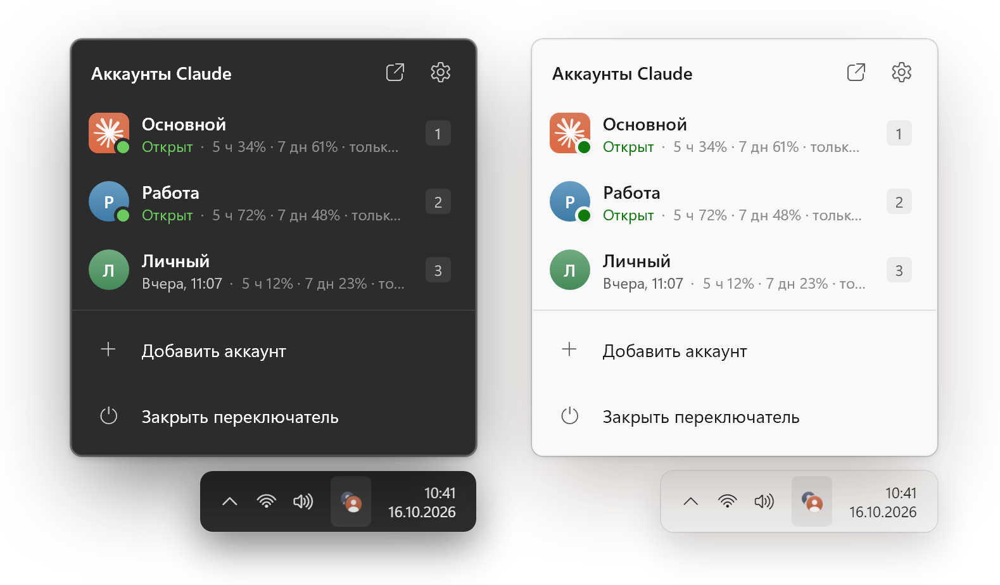
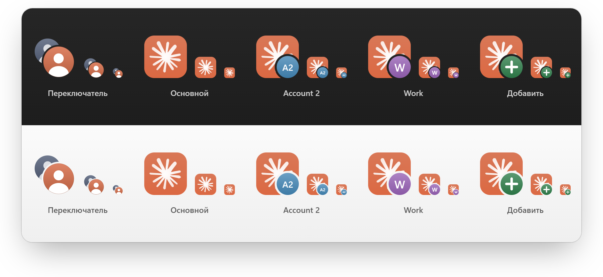
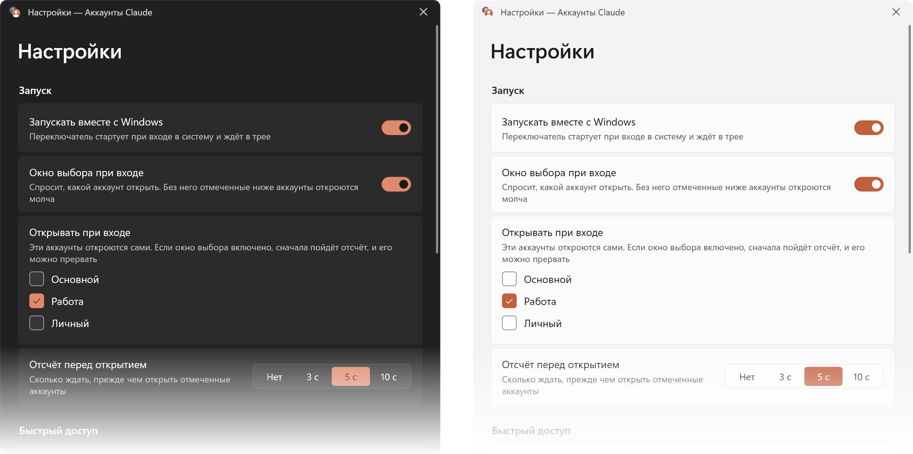

# Руководство

Всё, что умеет Claude Profile Switcher, в том порядке, в каком это обычно нужно. Коротко — в [README](../README.ru.md), как всё устроено внутри — в разделе [Как это работает](how-it-works.ru.md).

<sub>[English](guide.md)</sub>

- [Установка](#установка)
- [Окно выбора](#окно-выбора)
- [При входе в Windows](#при-входе-в-windows)
- [Трей](#трей)
- [Панель задач и ярлыки](#панель-задач-и-ярлыки)
- [Настройки](#настройки)
- [Перенос чатов Claude Code](#перенос-чатов-claude-code)
- [Лимиты на карточках](#лимиты-на-карточках)
- [Командная строка](#командная-строка)
- [Решение проблем](#решение-проблем)
- [Удаление](#удаление)

## Установка

1. Скачайте exe для своего процессора:

   | Процессор | Файл |
   | --- | --- |
   | Intel или AMD (почти все ПК) | [ClaudeProfileSwitcher-x64.exe](https://github.com/Piwqust/claude-switcher/releases/latest/download/ClaudeProfileSwitcher-x64.exe) |
   | ARM: Snapdragon, Surface Pro X и подобные | [ClaudeProfileSwitcher-arm64.exe](https://github.com/Piwqust/claude-switcher/releases/latest/download/ClaudeProfileSwitcher-arm64.exe) |

   Не знаете, какой у вас? Откройте **Параметры → Система → О системе** и посмотрите строку **Тип системы**.

2. Запустите скачанный файл. Программа сама установится в `%LOCALAPPDATA%\ClaudeProfiles\.switcher`, добавит ярлыки на рабочий стол и в меню «Пуск», включит запуск вместе с Windows и откроет окно выбора. Права администратора не нужны.

3. Скачанный файл после этого можно удалить: дальше работает установленная копия.

> [!NOTE]
> Exe не подписан сертификатом, поэтому при первом запуске Windows может показать «Windows защитил ваш компьютер». Нажмите **Подробнее → Выполнить в любом случае**. Это предупреждение появляется один раз: установленная копия его уже не вызывает. Если хотите убедиться, что файл не подменён, сверьте контрольную сумму с `SHA256SUMS.txt` в релизе:
>
> ```powershell
> Get-FileHash .\ClaudeProfileSwitcher-x64.exe -Algorithm SHA256
> ```

**Что нужно:** Windows 10 или 11 и установленный [Claude Desktop](https://claude.ai/download) из Microsoft Store или с сайта. Программа находит его сама.

**Обновление:** скачайте новую версию и запустите её. Она закроет старую, займёт её место и сохранит все аккаунты, имена и настройки. С переключателя на PowerShell (v2) тоже можно обновиться поверх.

## Окно выбора

<picture><source media="(prefers-color-scheme: light)" srcset="images/ru/picker-light.png"></picture>

На каждой карточке — номер, имя аккаунта, открыт он или когда открывался в последний раз, и лимиты, если о них есть свежие данные. Зелёная точка значит, что окно этого аккаунта уже открыто. Клик по такой карточке выводит окно на передний план и не запускает вторую копию.

**Первый новый аккаунт:**

1. Нажмите **Добавить**. Откроется новое окно Claude на экране входа.
2. Войдите в другой аккаунт. С этого момента оба аккаунта остаются в системе.
3. Нажмите <kbd>F2</kbd>, чтобы переименовать `Account 2`, например, в «Работа». Меняется только подпись, вход не затрагивается.

Меню «⋯» на карточке (или правый клик) содержит остальное: перезапуск Claude, «Открывать при входе в Windows», ярлык на рабочий стол, перенос чатов Code, папку профиля и удаление.

<br clear="right">

| Действие | Мышь | Клавиатура |
| --- | --- | --- |
| Открыть аккаунт или перейти к его окну | клик по карточке | <kbd>1</kbd>…<kbd>9</kbd> или <kbd>Enter</kbd> |
| Выбрать несколько и открыть разом | <kbd>Ctrl</kbd>+клик | <kbd>Пробел</kbd>, затем <kbd>Enter</kbd> |
| Добавить аккаунт | **Добавить** | <kbd>Ctrl</kbd>+<kbd>N</kbd> |
| Перезапустить открытый аккаунт | ⋯ → Перезапустить | <kbd>Ctrl</kbd>+<kbd>R</kbd> |
| Переименовать | ⋯ → Переименовать | <kbd>F2</kbd> |
| Удалить аккаунт | ⋯ → Удалить | <kbd>Del</kbd> |
| Меню карточки | правый клик или ⋯ | <kbd>Shift</kbd>+<kbd>F10</kbd> |
| Настройки | ⚙ | <kbd>Ctrl</kbd>+<kbd>,</kbd> |
| Закрыть окно | ✕ | <kbd>Esc</kbd> |
| Перемещаться между карточками | | <kbd>Tab</kbd> и стрелки |

Из любой программы: <kbd>Ctrl</kbd>+<kbd>Alt</kbd>+<kbd>C</kbd> — окно выбора, <kbd>Ctrl</kbd>+<kbd>Alt</kbd>+<kbd>1</kbd>…<kbd>9</kbd> — сразу нужный аккаунт. Сочетание для окна выбора можно поменять в настройках. Если его уже заняла другая программа, переключатель об этом скажет.

<p align="center">
  
</p>

## При входе в Windows

<picture><source media="(prefers-color-scheme: light)" srcset="images/ru/startup-light.png"></picture>

Переключатель стартует вместе с системой. Дальше есть два варианта:

- **Спросить, какой аккаунт открыть.** Окно выбора появляется сразу после входа.
- **Открыть отмеченные сами.** Отметьте аккаунты в меню карточки («Открывать при входе в Windows») или в настройках. Перед открытием идёт отсчёт: 3, 5 или 10 секунд. Любая клавиша или клик останавливает его, и можно выбрать другой аккаунт.

Если окно выбора при входе выключено, отмеченные аккаунты откроются без вопросов.

<br clear="right">

## Трей



После закрытия окна переключатель остаётся в трее. Он занимает около 20 МБ памяти и открывает окно мгновенно.

- **Левый клик** по значку открывает список аккаунтов с лимитами.
- **Правый клик** открывает обычное меню Windows: аккаунты, «Перезапустить Claude», «Добавить аккаунт…», «Настройки», «Закрыть переключатель».

**«Перезапустить Claude»** полностью закрывает Claude открытого аккаунта и запускает его заново: когда он завис или должен подхватить новые MCP-серверы и настройки. Собственный выход Claude только прячет его в трей, поэтому переключатель завершает весь процесс вместе с запущенными в нём чатами Claude Code; неотправленный текст в этом окне пропадёт. Если открыто несколько аккаунтов, пункт «Все открытые» перезапустит их разом.

Если трей не нужен, выключите в настройках «Оставаться в трее после закрытия окна»: переключатель будет закрываться вместе с окном.

<br clear="right">

## Панель задач и ярлыки

- **Список переходов.** Закрепите переключатель на панели задач. Правый клик по кнопке покажет все аккаунты.
- **Отдельная кнопка для каждого аккаунта.** Обычно Windows собирает все окна Claude в одну кнопку. Включите в настройках «Отдельные кнопки аккаунтов на панели задач», и у каждого окна появятся своя кнопка и свой значок. Функция экспериментальная.
- **Ярлыки.** «Ярлык на рабочий стол» в меню карточки создаёт `Claude - <имя>`. Его можно закрепить в «Пуске» или на панели задач и открывать аккаунт без окна выбора. Ярлыки продолжают работать после обновлений Claude.

<p align="center">
  
</p>

## Настройки

<p align="center">
  
</p>

Запуск вместе с Windows, окно выбора при входе, какие аккаунты открывать сами, длительность отсчёта, горячие клавиши, скрытие окна после запуска аккаунта, трей, отдельные кнопки на панели задач и язык интерфейса.

## Перенос чатов Claude Code

Меню карточки → **Перенести чаты Code…**. Отметьте чаты и выберите, в какой аккаунт их скопировать. В исходном аккаунте чат тоже останется. Обе копии продолжают одну и ту же историю, поэтому заканчивайте работу в одном аккаунте, прежде чем продолжать в другом.

> [!NOTE]
> В аккаунте, куда переносятся чаты, нужно хотя бы раз открыть вкладку Code. Если этот аккаунт открыт, перезапустите его, чтобы чаты появились.

## Лимиты на карточках

Карточки показывают, сколько процентов лимита использовано за 5 часов и за 7 дней. Цифра показывается, только если ей не больше 15 минут и лимит с тех пор не сбрасывался. Более старые данные скрываются: аккаунт могли использовать в браузере или в терминале, и устаревшая цифра ввела бы в заблуждение. Когда свежих данных нет, блок с лимитами просто не виден.

За этими цифрами переключатель не обращается к серверам Anthropic. Откуда они берутся — в разделе [Как это работает](how-it-works.ru.md#откуда-берутся-цифры-лимитов).

## Командная строка

| Команда | Что делает |
| --- | --- |
| `ClaudeProfileSwitcher.exe` | Открывает окно выбора. Если запущен не из папки установки — сначала устанавливается |
| `ClaudeProfileSwitcher.exe --launch "Работа"` | Открывает аккаунт или выводит его окно вперёд, затем завершается. Принимает имя или папку профиля |
| `ClaudeProfileSwitcher.exe --restart "Работа"` | Закрывает Claude этого аккаунта, открывает заново и завершается. Если аккаунт был закрыт, просто открывает |
| `ClaudeProfileSwitcher.exe --add-account` | Добавляет аккаунт и открывает Claude на экране входа |
| `ClaudeProfileSwitcher.exe --tray` | Запускает переключатель только в трее |
| `ClaudeProfileSwitcher.exe --startup` | То же, что делает Windows при входе: отсчёт или окно выбора |
| `ClaudeProfileSwitcher.exe --install` | Устанавливает или обновляет установку, потом открывает окно выбора |
| `ClaudeProfileSwitcher.exe --claude-path "<путь>\Claude.exe"` | Указывает путь к Claude, если его не удалось найти. Выбор запоминается |

## Решение проблем

<details>
<summary><b>«Не удалось найти приложение Claude»</b></summary>

Переключатель предложит выбрать `Claude.exe` вручную, выбор запомнится. То же самое делает `--claude-path`.
</details>

<details>
<summary><b>Горячая клавиша не срабатывает</b></summary>

Скорее всего, сочетание заняла другая программа. В настройках появится «Это сочетание занято другой программой» — задайте там другое.
</details>

<details>
<summary><b>Лимиты не показываются</b></summary>

Значит, свежих данных нет: Claude ещё не записал их или они старше 15 минут. Откройте аккаунт и поработайте в нём. Цифры появятся, когда Claude их обновит.
</details>

<details>
<summary><b>Ярлык ничего не открывает</b></summary>

Ошибки показываются в окне и пишутся в `%LOCALAPPDATA%\ClaudeProfiles\switcher-error.log`. Если профиль удалили или переименовали не через переключатель, старый ярлык сообщит, что такого аккаунта нет.
</details>

<details>
<summary><b>Интерфейс не на том языке</b></summary>

По умолчанию язык повторяет язык Windows: русский, если Windows на русском, иначе английский. «Настройки → Язык» → **English** или **Русский** закрепляет нужный.
</details>

## Удаление

1. В настройках выключите «Запускать вместе с Windows», затем в трее выберите «Закрыть переключатель».
2. Удалите папку `%LOCALAPPDATA%\ClaudeProfiles\.switcher` и ярлыки `Claude Profile Switcher`, `Claude - …` на рабочем столе и в меню «Пуск».
3. Чтобы удалить и сами профили со входами, удалите всю папку `%LOCALAPPDATA%\ClaudeProfiles`. Основной аккаунт Claude при этом не пострадает.
