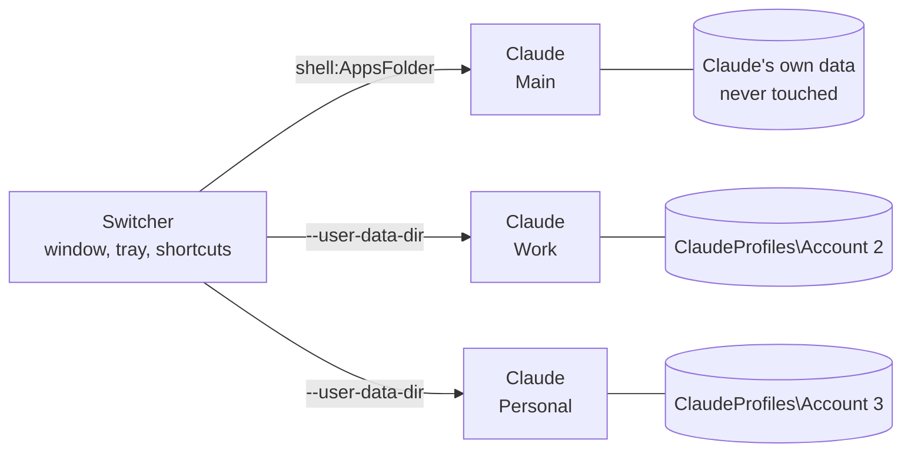

# How it works

What the switcher does to run several Claude Desktop accounts side by side, what it leaves alone, and how it differs from the script it started from. For using it, see the [user guide](guide.md).

[Русский](how-it-works.ru.md)

- [The idea](#the-idea)
- [Step by step](#step-by-step)
- [What each account has to itself, and what is shared](#what-each-account-has-to-itself-and-what-is-shared)
- [Details that matter](#details-that-matter)
- [Where the usage figures come from](#where-the-usage-figures-come-from)
- [Security and privacy](#security-and-privacy)
- [Compared with the original](#compared-with-the-original)

## The idea

Claude Desktop is built on Electron, and Electron honours the standard `--user-data-dir` switch. A profile is just a directory with its own cookie jar, Local Storage and `config.json`, so every profile is a fully independent sign-in. Electron's "one copy of the app" lock is per directory too, which is why copies pointed at different directories run side by side instead of focusing each other.

## Step by step

1. **Finds Claude.** The Store build through the per-user package repository in the registry, the installer build through its uninstall entry. The result is cached and checked again when Claude updates.
2. **Keeps profiles.** Each extra account is a folder in `%LOCALAPPDATA%\ClaudeProfiles`. Names, colours and the other settings sit in `settings.json` next to them.
3. **Opens an account.** The main account starts through `shell:AppsFolder`, like the Start menu does. Others start as `Claude.exe --user-data-dir=<profile>`. If an account is already open, its window is brought forward instead.
4. **Watches what is open.** A process snapshot plus each process's command line maps running Claude windows to profiles, on a background thread.
5. **Fits into Windows.** Shortcuts get per-account icons drawn with Direct2D, the taskbar gets a jump list, start with Windows is one `Run` value, and the optional per-account taskbar buttons set each window's `AppUserModelID`.

## What each account has to itself, and what is shared

**Separate per account:** sign-in, chats, window settings, cache, the Code chat list.

**Shared by all of them:**

- **Claude Code.** Its settings, plugins, MCP servers and session history live in `%USERPROFILE%\.claude` and `.claude.json`, one set for every account.
- **One code folder.** Code sessions in two windows working in the same repository can edit the same files at once.
- **Claude's own quick-entry hotkey** goes to whichever copy started first.
- **`claude://` links and Claude in Chrome** always use the main account.
- **Memory.** Each open account is a full copy of the app; budget roughly one Claude per window.
- **Updates.** Claude updates once for everyone. Windows already open stay on the old version until restarted.

## Details that matter

- **The main account is never modified.** The Microsoft Store build is started through `shell:AppsFolder` rather than by running the exe, so it keeps its package identity: auto update, `claude://` links and native messaging behave exactly as before. The profiles the switcher creates live in `%LOCALAPPDATA%\ClaudeProfiles`, away from Claude's data.
- **Claude's path changes with every update**, because it contains the version number. Shortcuts look Claude up when clicked and carry their own icons, so they survive updates.
- **Open windows are detected by Claude Desktop's own process.** The Claude Code CLI is also called `claude.exe`; those processes are ignored.
- **Renaming changes a label only.** The folder name is a profile's permanent id, because Electron stores absolute paths inside its data.
- **Separate taskbar buttons** work by giving each account's windows their own `AppUserModelID`. Claude itself is not changed.

## Where the usage figures come from

The switcher never contacts Anthropic's servers and never touches tokens. The figures come from files already on your PC:

| Source | What it holds |
| --- | --- |
| `<profile>\plan-usage-history.json` | Claude Desktop's own record, one per profile |
| `%USERPROFILE%\.claude.json` | The last server answer Claude Code saved, matched to the account by its id |

A figure is shown only if it is at most 15 minutes old and its window has not reset since.

## Security and privacy

- **No network access.** The switcher makes no network requests at all: there is no networking code, no telemetry and no update check.
- **Sign-ins are never touched.** Tokens, cookies and passwords are not read or copied. Each account signs in by itself in its own Claude window.
- **Claude is not modified.** Only standard Electron and Windows mechanisms; no patching, no proxy.
- **No admin rights.** Everything goes into your user profile: `%LOCALAPPDATA%\ClaudeProfiles` and an `HKCU\…\Run` value for start with Windows.
- **Built in the open.** Every release is built by [GitHub Actions](https://github.com/Piwqust/claude-switcher/actions) from this repository, with SHA-256 checksums next to the files.

Found a vulnerability? See [SECURITY.md](../SECURITY.md).

## Compared with the original

Claude Profile Switcher started from [Claude Code Desktop Switcher](https://github.com/PriyanshuGeTRekT/Claude-Code-Desktop-Switcher) by [@PriyanshuGeTRekT](https://github.com/PriyanshuGeTRekT), the PowerShell script that worked out how to run several Claude Desktop accounts side by side. The idea and the files on disk are the same, so an existing setup carries straight over. Everything else was rewritten from scratch in C++: the interface, the launcher, the tray, the installer and the shell integration.

| | Claude Code Desktop Switcher 2.0 | Claude Profile Switcher 1.0 |
| --- | --- | --- |
| Written in | PowerShell and WinForms | C++, Win32, Direct2D, DirectWrite |
| What you run | a `.ps1` script through `powershell.exe` | one 550 KB exe |
| Window appears in | about 10 s | **about 75 ms** |
| Memory | about 126 MB | **about 16 MB** |
| Install | a PowerShell command with `-ExecutionPolicy Bypass` | run the exe |
| Builds | — | x64 and ARM64 |
| Interface | English, light only | English and Russian, dark and light, Mica |
| Ask at sign-in, countdown | — | ✓ |
| Global shortcuts | — | <kbd>Ctrl</kbd>+<kbd>Alt</kbd>+<kbd>C</kbd>, <kbd>Ctrl</kbd>+<kbd>Alt</kbd>+<kbd>1</kbd>…<kbd>9</kbd> |
| Usage on the cards | — | ✓ |
| Open several accounts at once | — | ✓ |
| Tray | right-click menu | flyout and menu |
| Jump list, a taskbar button per account | — | ✓ |
| Coloured shortcut icons, moving Code chats | ✓ | ✓ |

Measured on the same Windows 11 PC with three accounts: time from starting the program to a visible window, and private memory once it settles.

### Why it is faster

- **Nothing to start first.** The script has to start PowerShell and .NET, then compile its Win32 helpers with `Add-Type`, on every launch. The exe is native code, ready the moment Windows loads it.
- **Straight to the system.** Finding the Store build is one registry read instead of `Get-AppxPackage`. Open windows come from a process snapshot and `NtQueryInformationProcess` instead of a WMI query.
- **Its own drawing.** Each window is drawn by the switcher in one pass with Direct2D and DirectWrite, with no control tree to build. Slow work, such as the process list and profile files, runs on a background thread, so the window never waits for it.
- **Cheap to keep around.** In the tray it is a small exe and one hidden window, so the picker, the global shortcuts and desktop shortcuts all answer in milliseconds.
