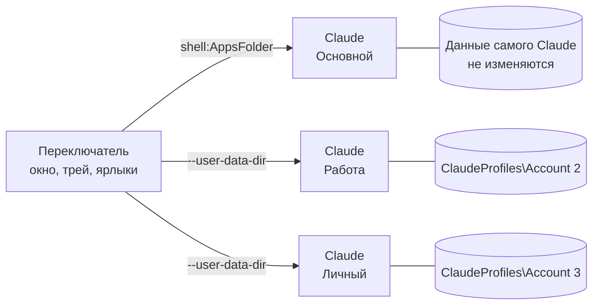

# Как это работает

Что делает переключатель, чтобы несколько аккаунтов Claude Desktop работали одновременно, что он не трогает и чем отличается от скрипта, с которого всё началось. Как пользоваться — в [руководстве](guide.ru.md).

[English](how-it-works.md)

- [Идея](#идея)
- [По шагам](#по-шагам)
- [Что у аккаунтов своё, а что общее](#что-у-аккаунтов-своё-а-что-общее)
- [Подробности, которые важны](#подробности-которые-важны)
- [Откуда берутся цифры лимитов](#откуда-берутся-цифры-лимитов)
- [Безопасность и приватность](#безопасность-и-приватность)
- [Сравнение с оригиналом](#сравнение-с-оригиналом)

## Идея

Claude Desktop построен на Electron, а Electron поддерживает стандартный параметр `--user-data-dir`. Профиль — это просто отдельная папка со своими cookie, локальным хранилищем и `config.json`. Поэтому каждый профиль — полностью независимый вход. Блокировка «только одна копия приложения» тоже действует в пределах папки. Копии с разными папками работают параллельно и не перехватывают друг друга.

## По шагам

1. **Находит Claude.** Версию из Store — по реестру пакетов пользователя, версию с сайта — по записи об установке. Результат запоминается и перепроверяется, когда Claude обновляется.
2. **Хранит профили.** Каждый дополнительный аккаунт — это папка в `%LOCALAPPDATA%\ClaudeProfiles`. Имена, цвета и остальные настройки лежат рядом, в `settings.json`.
3. **Открывает аккаунт.** Основной запускается через `shell:AppsFolder`, как из меню «Пуск». Остальные — как `Claude.exe --user-data-dir=<профиль>`. Если аккаунт уже открыт, его окно просто выводится вперёд.
4. **Следит за открытыми окнами.** Снимок процессов и командная строка каждого процесса сопоставляют окна Claude с профилями. Всё это идёт в фоновом потоке.
5. **Встраивается в Windows.** Ярлыки получают значки аккаунтов, нарисованные через Direct2D. На панели задач появляется список переходов, автозапуск — это одно значение `Run`. Отдельные кнопки на панели задач задают каждому окну свой `AppUserModelID`.

## Что у аккаунтов своё, а что общее

**У каждого аккаунта своё:** вход, переписка, настройки окна, кэш, список чатов Code.

**Общее для всех:**

- **Claude Code.** Его настройки, плагины, MCP-серверы и история сессий лежат в `%USERPROFILE%\.claude` и `.claude.json`. Это общая папка, у всех аккаунтов настройки Code одинаковые.
- **Одна папка с кодом.** Если в двух окнах запустить сессии Code в одном репозитории, они могут одновременно править одни и те же файлы.
- **Горячая клавиша самого Claude** (быстрый ввод) достаётся той копии, которая запустилась первой.
- **Ссылки `claude://` и расширение Claude для Chrome** всегда работают с основным аккаунтом.
- **Память.** Каждый открытый аккаунт — полноценная копия приложения. Рассчитывайте примерно на одного Claude на каждое окно.
- **Обновления.** Claude обновляется один раз для всех. Уже открытые окна остаются на старой версии до перезапуска.

## Подробности, которые важны

- **Основной аккаунт не изменяется.** Версия из Microsoft Store запускается через `shell:AppsFolder`, а не напрямую через exe. Поэтому у неё сохраняются автообновление, ссылки `claude://` и native messaging. Профили, которые создаёт переключатель, лежат в `%LOCALAPPDATA%\ClaudeProfiles`, отдельно от данных Claude.
- **Путь к Claude меняется с каждым обновлением**, потому что в нём номер версии. Ярлыки ищут Claude в момент клика и хранят свои значки, поэтому переживают обновления.
- **Открытые окна определяются по процессу самого Claude Desktop.** Claude Code CLI тоже называется `claude.exe`, такие процессы не учитываются.
- **Переименование меняет только подпись.** Имя папки — постоянный идентификатор профиля, потому что Electron хранит внутри данных абсолютные пути.
- **Отдельные кнопки на панели задач** работают так: переключатель задаёт окнам аккаунтов свой `AppUserModelID`. Сам Claude при этом не изменяется.

## Откуда берутся цифры лимитов

Переключатель не обращается к серверам Anthropic и не трогает токены. Цифры берутся из файлов, которые уже лежат на вашем компьютере:

| Источник | Что там |
| --- | --- |
| `<профиль>\plan-usage-history.json` | Записи самого Claude Desktop, отдельные для каждого профиля |
| `%USERPROFILE%\.claude.json` | Последний ответ сервера, который сохранил Claude Code. Сопоставляется с аккаунтом по его идентификатору |

Цифра показывается, только если ей не больше 15 минут и лимит с тех пор не сбрасывался.

## Безопасность и приватность

- **Нет сети.** Переключатель не делает ни одного сетевого запроса: в нём нет кода для работы с сетью, телеметрии и проверки обновлений.
- **Не трогает вход.** Токены, cookie и пароли не читаются и не копируются. Каждый аккаунт входит сам в своём окне Claude.
- **Claude не изменяется.** Используются только стандартные параметры Electron и Windows. Файлы Claude не патчатся, прокси нет.
- **Без прав администратора.** Всё ставится в профиль пользователя: `%LOCALAPPDATA%\ClaudeProfiles` и ключ `HKCU\…\Run` для автозапуска.
- **Открытый код.** Каждый релиз собирается в [GitHub Actions](https://github.com/Piwqust/claude-switcher/actions) из этого репозитория, контрольные суммы лежат рядом с файлами.

Нашли уязвимость? Напишите по инструкции в [SECURITY.md](../SECURITY.md).

## Сравнение с оригиналом

Claude Profile Switcher вырос из [Claude Code Desktop Switcher](https://github.com/PriyanshuGeTRekT/Claude-Code-Desktop-Switcher) от [@PriyanshuGeTRekT](https://github.com/PriyanshuGeTRekT). Это скрипт на PowerShell, в котором впервые придумали, как запускать несколько аккаунтов Claude Desktop одновременно. Идея и файлы на диске остались прежними, поэтому существующие аккаунты переносятся сами. Всё остальное переписано с нуля на C++: интерфейс, запуск, трей, установка и встраивание в Windows.

| | Claude Code Desktop Switcher 2.0 | Claude Profile Switcher 1.0 |
| --- | --- | --- |
| Написан на | PowerShell и WinForms | C++, Win32, Direct2D, DirectWrite |
| Что запускается | скрипт `.ps1` через `powershell.exe` | один exe на 550 КБ |
| Окно появляется за | около 10 с | **около 75 мс** |
| Память | около 126 МБ | **около 16 МБ** |
| Установка | команда PowerShell с `-ExecutionPolicy Bypass` | запустить exe |
| Сборки | — | x64 и ARM64 |
| Интерфейс | английский, только светлая тема | английский и русский, тёмная и светлая темы, Mica |
| Выбор при входе, отсчёт | — | ✓ |
| Глобальные горячие клавиши | — | <kbd>Ctrl</kbd>+<kbd>Alt</kbd>+<kbd>C</kbd>, <kbd>Ctrl</kbd>+<kbd>Alt</kbd>+<kbd>1</kbd>…<kbd>9</kbd> |
| Лимиты на карточках | — | ✓ |
| Несколько аккаунтов разом | — | ✓ |
| Трей | меню по правому клику | панель и меню |
| Список переходов, своя кнопка на панели задач | — | ✓ |
| Цветные значки ярлыков, перенос чатов Code | ✓ | ✓ |

Замерено на одном и том же ПК с Windows 11 и тремя аккаунтами: время от запуска программы до появления окна и личная память процесса после запуска.

### Почему быстрее

- **Нечего запускать заранее.** Скрипту при каждом старте нужно поднять PowerShell и .NET, а потом скомпилировать свои Win32-обёртки через `Add-Type`. Exe — это машинный код, он готов сразу после загрузки.
- **Напрямую к системе.** Версию из Store переключатель находит одним чтением реестра вместо `Get-AppxPackage`. Открытые окна он узнаёт из снимка процессов и `NtQueryInformationProcess` вместо запроса WMI.
- **Свой рендеринг.** Каждое окно рисуется за один проход через Direct2D и DirectWrite, без дерева элементов управления. Медленная работа — список процессов, файлы профилей — идёт в фоновом потоке, и окно её не ждёт.
- **Дёшево держать в трее.** В трее это маленький exe и одно скрытое окно, поэтому окно выбора, горячие клавиши и ярлыки срабатывают за миллисекунды.
